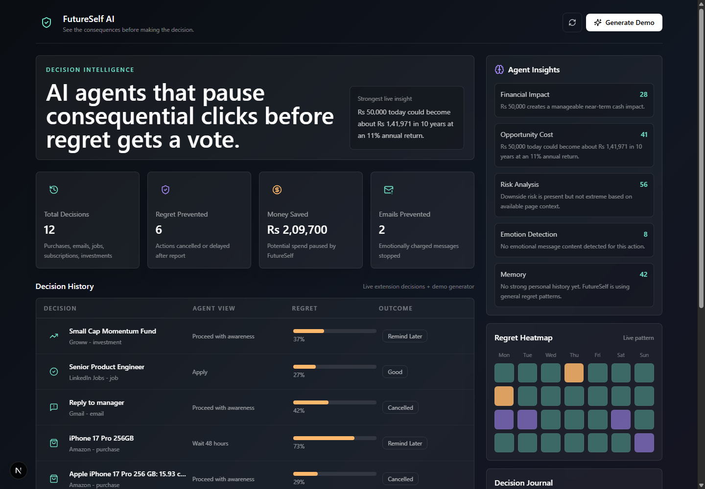
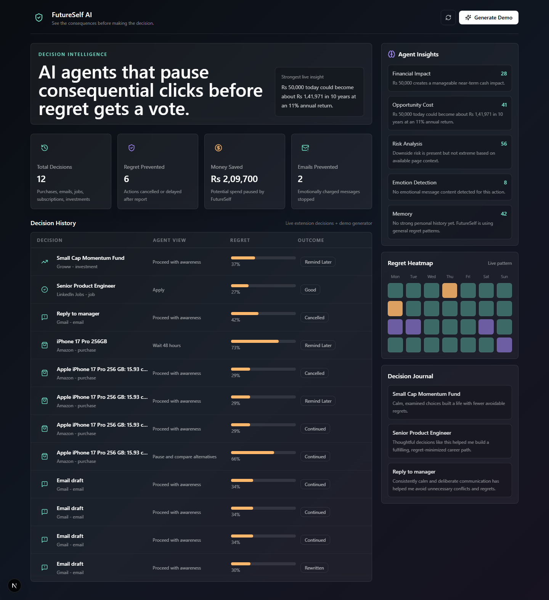

# FutureSelf AI

A Chrome extension that pauses an important online action, such as a purchase, job application, trade or email, and shows a report on its likely consequences before you continue.

## Why this exists
A hackathon project about impulsive online decisions: the idea was to add a short, informed pause at the moment of clicking "buy", "apply" or "send".

## What it does
- Intercepts actions on Amazon, Flipkart, Gmail, LinkedIn Jobs, Naukri, Indeed, Zerodha and Groww
- Runs agents in parallel for financial impact, opportunity cost, risk, emotion detection and past-decision memory
- Shows a Future Impact Report before the action goes through
- Keeps decision history in Chrome storage and in a Next.js dashboard backed by PostgreSQL
- Optionally adds OpenAI reasoning and ChromaDB memory; works without an API key
- Includes a demo-data generator

## Project structure
```
future-self-ai/
├── apps/
│   ├── extension/  Chrome MV3 extension (React, TypeScript)
│   └── web/        Next.js dashboard and API, Prisma schema
├── dashboard-screenshot.png           Dashboard preview
├── dashboard-fullpage-screenshot.png  Full dashboard preview
└── package.json                       Workspace scripts
```

## Getting started
Requirements: Node.js 18+, PostgreSQL, Google Chrome.
```bash
git clone https://github.com/abhijha8287/future-self-ai.git
cd future-self-ai
npm install
cp apps/web/.env.example apps/web/.env.local
npm run dev                       # http://localhost:3000/dashboard
npm run build:extension
```
In Chrome, open `chrome://extensions`, turn on Developer Mode, click **Load unpacked** and select `apps/extension/dist`.

## Configuration
| Variable | Purpose |
|:--|:--|
| `DATABASE_URL` | PostgreSQL connection |
| `OPENAI_API_KEY`, `OPENAI_MODEL` | Optional OpenAI reasoning (default `gpt-4.1-mini`) |
| `DISABLE_OPENAI` | `true` to run without OpenAI |
| `CHROMA_URL`, `CHROMA_COLLECTION` | Optional ChromaDB memory |

## Tech stack
TypeScript, React, Chrome Extension Manifest V3, Tailwind CSS, Framer Motion, Next.js, Prisma, PostgreSQL, ChromaDB, OpenAI API

## Screenshots

### Dashboard overview



### Dashboard full view



## Demo mode

Demo mode is enabled in the extension popup by default. The extension tries to call:

```text
http://localhost:3000/api/analyze
```

If the backend is unavailable, it falls back to a local demo report so judges can still see the full modal flow.

Dashboard demo data is available at:

```text
GET /api/demo
```

## API

Analyze a decision:

```http
POST /api/analyze
Content-Type: application/json
```

Example body:

```json
{
  "decisionType": "purchase",
  "website": "Amazon",
  "title": "iPhone 17 Pro",
  "price": 149900,
  "category": "Smartphones",
  "actionLabel": "Buy Now",
  "url": "https://www.amazon.in/demo",
  "capturedAt": "2026-06-03T00:00:00.000Z"
}
```

Output:

```json
{
  "decisionType": "purchase",
  "regretProbability": 68,
  "confidenceScore": 84,
  "recommendation": "Wait 48 hours",
  "insights": []
}
```

## Deployment

Dashboard and API:

- Deploy `apps/web` to Vercel.
- Set the environment variables in Vercel.
- Update the extension popup Backend API URL to the deployed Vercel URL.

Database:

- Create PostgreSQL on Railway, Render, Supabase, or Neon.
- Set `DATABASE_URL`.
- Use `apps/web/prisma/schema.prisma` as the schema.

Vector memory:

- Run ChromaDB separately.
- Set `CHROMA_URL` and `CHROMA_COLLECTION`.
